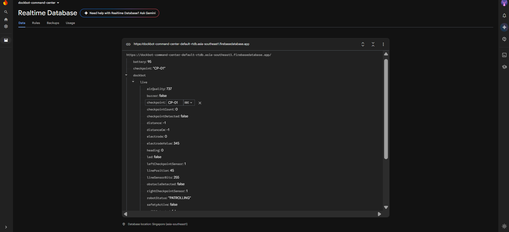

# 📊 DockBot – Live Monitoring Dashboard

## Overview

The DockBot dashboard provides a remote monitoring interface for the autonomous warehouse patrol robot.

It receives sensor information and robot status from Firebase Realtime Database, allowing users to monitor the robot's operation and identify potential hazards.

## Dashboard Features

- **Robot Status:** Displays whether DockBot is patrolling or in emergency-stop mode.
- **Liquid Spill Monitoring:** Displays liquid spill detection alerts.
- **Obstacle Monitoring:** Shows obstacle detection status.
- **Air Quality Monitoring:** Displays raw MQ-135 sensor readings.
- **Distance Monitoring:** Displays ultrasonic distance measurements.
- **Live Sensor Updates:** Receives updated telemetry through Firebase.

## Dashboard Screenshots

### 1. Dashboard Overview

### 2. Live Sensor Readings

### 3. Liquid Spill Detection

### 4. Obstacle Detection

### 5. Firebase Realtime Database

## Data Source

The ESP32 sends sensor readings and robot status to Firebase Realtime Database through Wi-Fi.

The dashboard uses this data to display:

- Robot operating status
- Liquid spill detection
- Obstacle detection
- Electrode sensor readings
- MQ-135 raw analog readings
- Ultrasonic distance

## Purpose

The dashboard acts as the remote monitoring interface of DockBot, helping warehouse operators observe robot activity and receive information about detected hazards.

---

**Project:** DockBot – Autonomous Warehouse Patrol & Hazard Monitoring Robot

**Competition:** COLOSSUS – Hardware / IoT & Robotics Track
