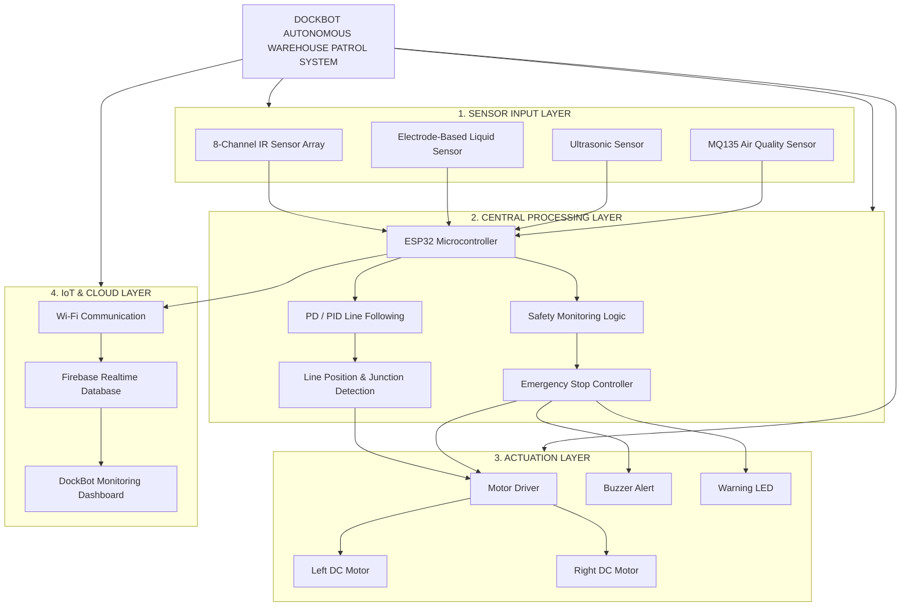

# DockBot – System Architecture

## Overview

The DockBot system architecture consists of four major layers: Sensor Input, Central Processing, Actuation, and IoT & Cloud Communication.

The ESP32 serves as the central controller, processing sensor information, executing navigation logic, monitoring safety conditions, controlling the motors and transmitting telemetry to Firebase.

## Architecture Diagram

## Layer Description

### 1. Sensor Input Layer
- IR sensor array detects the navigation line.
- Electrode sensor detects liquid spills.
- Ultrasonic sensor measures obstacle distance.
- MQ135 monitors air-quality sensor response.

### 2. Central Processing Layer
- ESP32 processes all sensor inputs.
- PD controller calculates motor corrections.
- Junction detection identifies programmed turns.
- Safety logic prioritizes spill and obstacle conditions.

### 3. Actuation Layer
- Motor driver controls the left and right motors.
- Buzzer provides an audible spill warning.
- LED provides a visual obstacle warning.
- Emergency stop disables motor outputs when a safety condition is detected.

### 4. IoT & Cloud Layer
- ESP32 connects to Wi-Fi.
- Firebase Realtime Database receives sensor telemetry.
- Monitoring dashboard displays the transmitted robot status and sensor readings.

## System Operation

The sensor layer continuously collects environmental and navigation information. The ESP32 processes these inputs and executes the appropriate navigation or safety response.

During normal operation, the robot follows the designated warehouse track. When a spill or obstacle is detected, the safety controller overrides normal motor commands and stops the robot.

Sensor information is also transmitted to Firebase for remote monitoring.

**Controller:** ESP32  
**Cloud Platform:** Firebase Realtime Database  
**Communication:** Wi-Fi / HTTPS
